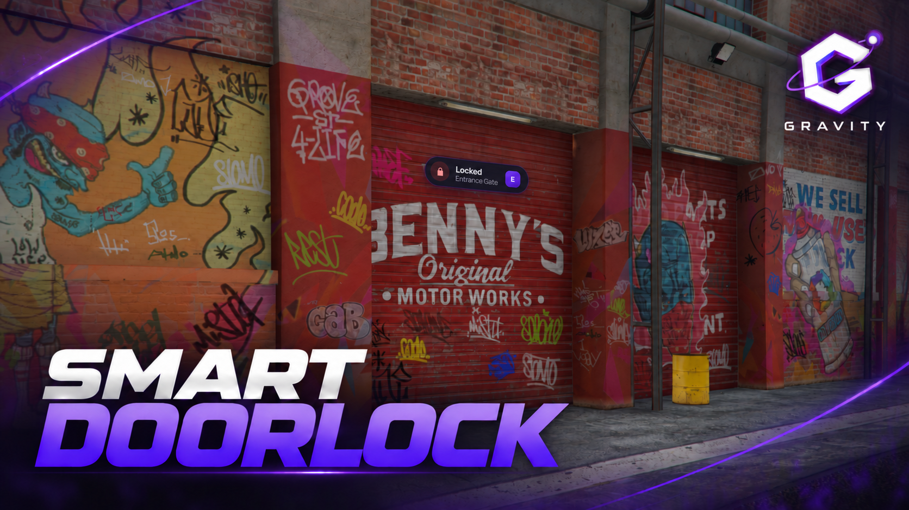
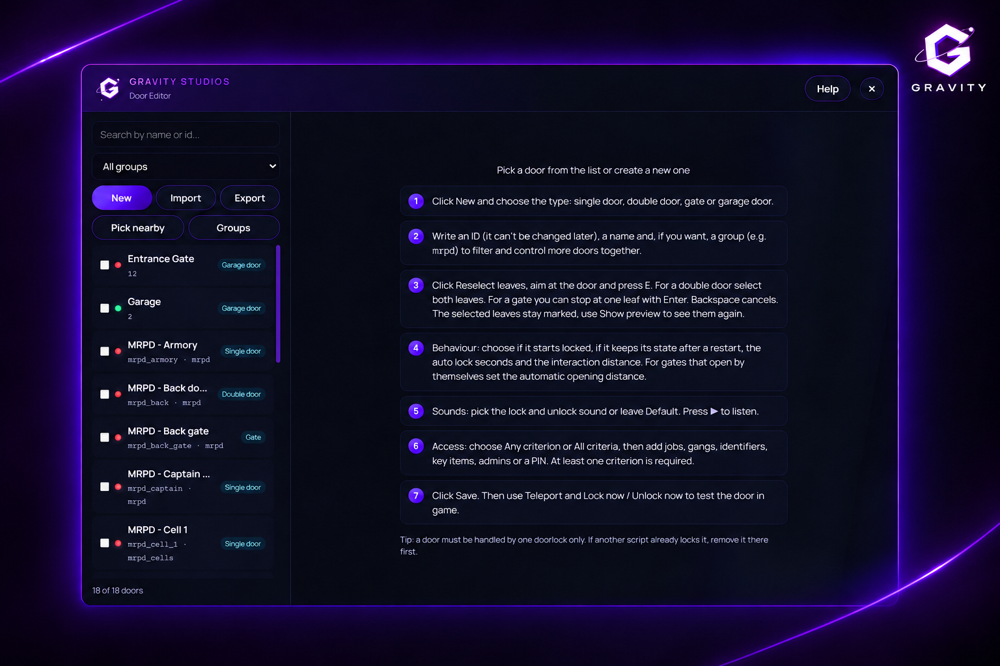
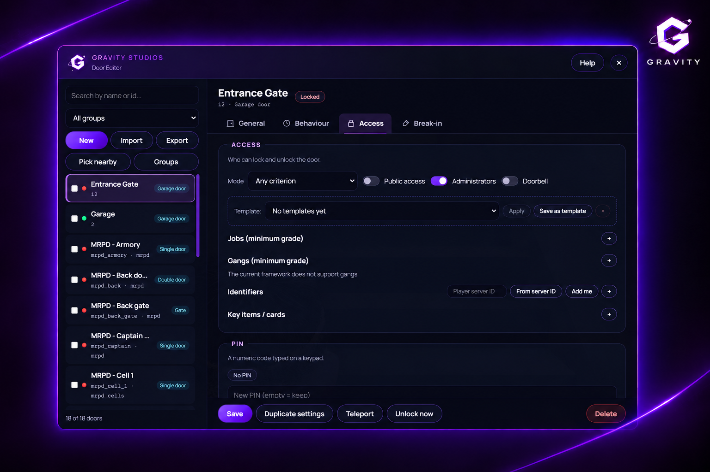
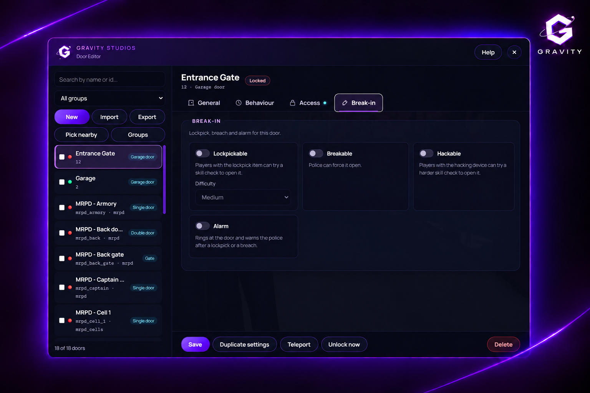
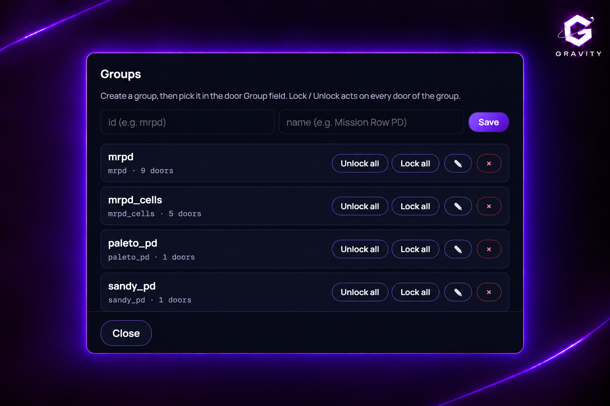
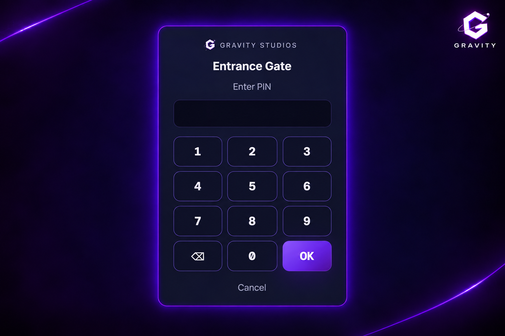

# g_doorlock



A free FiveM doorlock resource by Gravity Studios. Supports single and double doors, gates and garage doors, with an in-game editor, server-side access checks and synchronized lock states.

## Features

- In-game editor (`/dooradmin`): create, edit, group, import and export doors
- Access by job, gang, identifier, item (with metadata) or PIN
- Lockpicking, hacking and breaching with configurable minigames, alarms and door repair
- Doorbell, garage remote, opening hours, automatic gates
- Import from ox_doorlock and qb-doorlock; included door packs
- Configurable notifications and text UI
- ESX, QBCore, QBX or standalone · ox_inventory, qs-inventory, qb-inventory or ESX inventory
- 6 languages: en, it, de, fr, es, pt

## Showcase











## Requirements

- OneSync
- [ox_lib](https://github.com/overextended/ox_lib)
- [oxmysql](https://github.com/overextended/oxmysql)
- Optional: ox_target. Keyboard controls: `E` to interact, `G` for break-in actions.

## Installation

1. Put `g_doorlock` in your resources (keep the folder name).
2. Import `sql/install.sql` (tables are also created on start).
3. Add to `server.cfg` after your framework and inventory:

```cfg
ensure g_doorlock

add_ace group.admin g_doorlock.admin allow    # editor
add_ace group.admin g_doorlock.bypass allow   # "Administrators" criterion on doors
set g_doorlock_webhook "https://discord.com/api/webhooks/..."   # optional
```

4. Add the items you use to your inventory (see below).

## NUI branding

Configure the name and logo in `config.lua`. The same settings apply to the editor, PIN keypad and door-selection overlay:

```lua
Config.NUI = {
    watermark = true,
    serverName = 'Gravity Studios',
    logo = 'img/logo.png',
}
```

Set `watermark = false` to hide the logo while keeping the server name. An empty `serverName` hides the name; an empty `logo` hides the logo. Product labels and functional titles remain visible.

Place custom logos in `web/public/img/` and use a path such as `img/my-server.png`, then rebuild the NUI (see below). Restart `g_doorlock` after changing the configuration.

## Building the NUI

The interface is React + TypeScript (Vite) in `web/src`, served from `web/dist`. Release zips already contain the build. From a git checkout, build it once with Node 18 or newer:

```
cd web
npm install
npm run build
```

`npm run release` (from the resource folder) builds and writes `release/g_doorlock-<version>.zip` without the sources. Locale texts and `Config.NUI` are sent from Lua, so changing them needs no rebuild.

## NUI theme

`Config.NUI.theme.colors` controls the shared palette for the editor, dialogs, keypad, door HUD and built-in notifications. Use six-digit hex colors; missing or invalid values keep the Gravity defaults. Partial overrides are supported:

```lua
Config.NUI.theme = {
    colors = {
        primary = '#007c91',
        accent = '#00a6ad',
        highlight = '#9ae8e8',
        success = '#62d2e8',
    },
    fonts = { body = 'Barlow Condensed', headings = 'Bebas Neue' },
}
```

The full color list is in `config.lua`. Primary gradients follow a changed primary color; optional `gradientStart` and `gradientEnd` override their endpoints. Font choices apply separately to body text and headings. Barlow Condensed, Bebas Neue and DM Mono are packaged locally; another family requires its own local font files, CSS declaration, license and manifest entry. The management frame keeps the same dimensions across tabs.

## Integration bridge

Select integrations in `Config.Bridge`; no additional framework or inventory is required beyond the one you select.

| Setting | Supported providers |
| --- | --- |
| framework | `auto`, `esx`, `qb`, `qbx`, `standalone` |
| inventory | `auto`, `ox_inventory`, `qs-inventory`, `qb-inventory`, `esx`, `none` |
| target | `auto`, `ox_target`, `builtin` (keyboard) |
| notify | `auto`, `g_doorlock`, `ox_lib`, `esx`, `qb`, `qbx`, `okokNotify`, `mythic_notify`, `brutal_notify`, `wasabi_notify`, `custom` |
| textUI | `auto`, `g_doorlock`, `ox_lib`, `esx`, `qb`, `okokTextUI`, `cd_drawtextui`, `jg-textui`, `custom`, `false` |
| progress | `auto`, `ox_lib` (circle), `ox_lib_bar`, `qb` (`progressbar`), `esx` (`esx_progressbar`) |
| menu | `auto`, `ox_lib`, `qb` (`qb-menu`), `esx` (`esx_context`) |
| logs | `console`, `discord`, `ox_lib`, `none` |

Start selected external resources before `g_doorlock`. Framework/inventory auto-detection keeps its existing priority. Target auto uses ox_target when started, otherwise keyboard controls. Notify, TextUI, progress and menu auto use ox_lib. Missing or unknown UI providers produce a console warning and fall back to the built-in notification/TextUI, keyboard controls, or ox_lib progress/menu. A progress error or provider shutdown cancels the action.

`notifyPosition` accepts `top`, `top-right` or `bottom-right` for the built-in notifications and ox_lib. `textUIPosition` accepts `bottom`, `left` or `right` for the built-in HUD and ox_lib. QBCore and okokTextUI use left/right, with bottom mapped to left; other adapters retain their own placement. External providers keep their own visual theme.

The progress provider controls default breach and repair progress; existing custom minigames remain supported. Custom notification and TextUI providers use the existing `Config.Notify.custom` and `Config.TextUI.show/hide` hooks. Legacy `Config.Framework`, `Config.Inventory`, `Config.Interaction.target`, `Config.Notify.system` and `Config.TextUI.system` are read when the corresponding bridge field is absent. Explicit bridge fields take precedence.

Logs default to Discord with the existing action filter; console debug output still follows `Config.Debug`. `console` writes every log action, `none` disables resource logs, and `ox_lib` uses the logger configured in ox_lib. The Discord webhook and action filter remain in `config_server.lua`; use the non-replicated `g_doorlock_webhook` convar. Only theme, branding and UI positions are sent to the NUI.

Restart the resource after configuration changes.

## Items

Add the missing entries to your inventory's item table. `keycard` is optional and can be configured as a door key in the editor.

### ox_inventory

Add to `ox_inventory/data/items.lua` ([item format](https://overextended.dev/docs/ox_inventory/Guides/creatingItems)).

```lua
['lockpick'] = {
    label = 'Lockpick', weight = 100, stack = true, close = true,
    description = 'A tool for picking door locks.',
},
['hacking_device'] = {
    label = 'Hacking Device', weight = 1000, stack = false, close = true,
    description = 'A device for bypassing electronic door locks.',
},
['garage_remote'] = {
    label = 'Garage Remote', weight = 50, stack = false, close = true, consume = 0,
    description = 'A remote control for gates and garage doors.',
    client = { export = 'g_doorlock.useRemote' },
},
['keycard'] = {
    label = 'Keycard', weight = 10, stack = false, close = true,
    description = 'An access card for a door or group of doors.',
},
```

### qs-inventory

Add to `qs-inventory/shared/items.lua` for ESX or `qb-core/shared/items.lua` for QBCore ([item locations](https://www.quasar-store.com/docs/advanced-inventory/installation#item-management)). Use matching item images in `qs-inventory/html/images/`.

```lua
['lockpick'] = {
    name = 'lockpick', label = 'Lockpick', weight = 100, type = 'item', image = 'lockpick.png',
    unique = false, useable = false, shouldClose = true,
    description = 'A tool for picking door locks.',
},
['hacking_device'] = {
    name = 'hacking_device', label = 'Hacking Device', weight = 1000, type = 'item', image = 'hacking_device.png',
    unique = true, useable = false, shouldClose = true,
    description = 'A device for bypassing electronic door locks.',
},
['garage_remote'] = {
    name = 'garage_remote', label = 'Garage Remote', weight = 50, type = 'item', image = 'garage_remote.png',
    unique = true, useable = true, shouldClose = true,
    description = 'A remote control for gates and garage doors.',
    client = { export = 'g_doorlock.useRemote' },
},
['keycard'] = {
    name = 'keycard', label = 'Keycard', weight = 10, type = 'item', image = 'keycard.png',
    unique = true, useable = false, shouldClose = true,
    description = 'An access card for a door or group of doors.',
},
```

## Exports

```lua
local dl = exports.g_doorlock

dl:lockDoor('mrpd_front')
dl:unlockDoor('vault', 60)            -- relock after 60 s
dl:setGroupState('mrpd', true)
dl:isLocked('mrpd_front')
dl:canAccess(source, 'mrpd_armory')
dl:setTempAccess('house_12', { identifiers = { 'ABC123' } }, 3600)
dl:addTempPin('motel_12', '4821', 86400)
```

Server event: `g_doorlock:stateChanged (id, locked, src, reason)`. More hooks in `hooks.lua`.

## License

[GPL-3.0](LICENSE)
